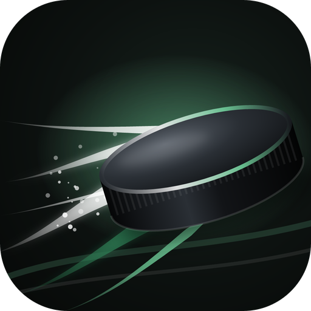
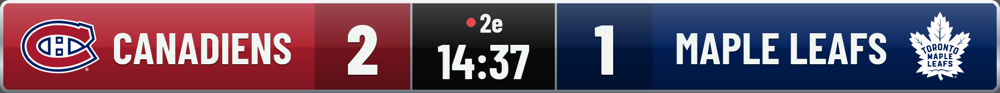
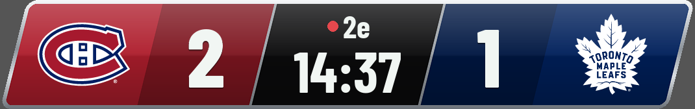
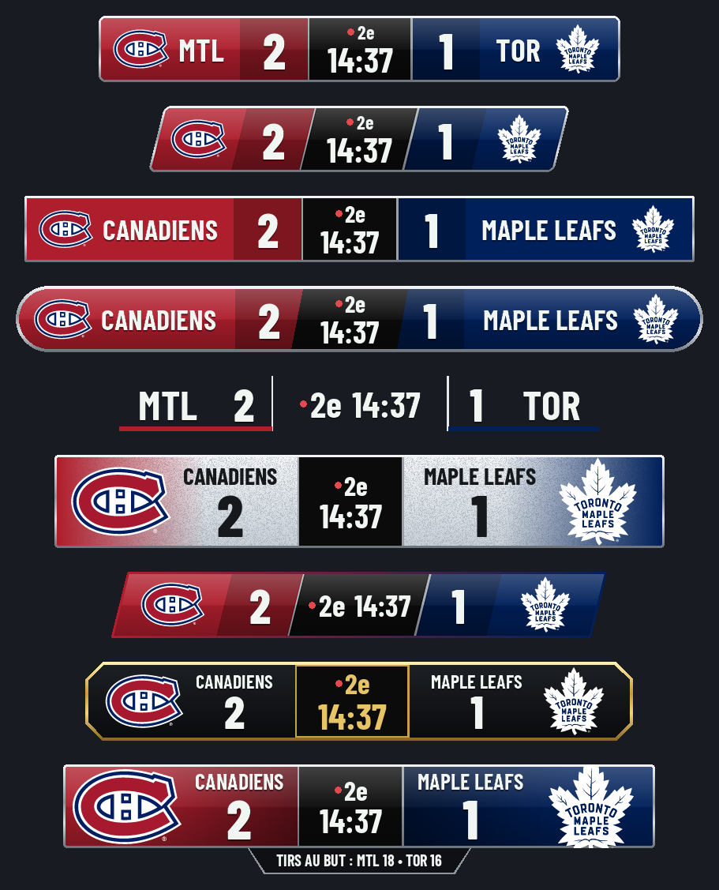
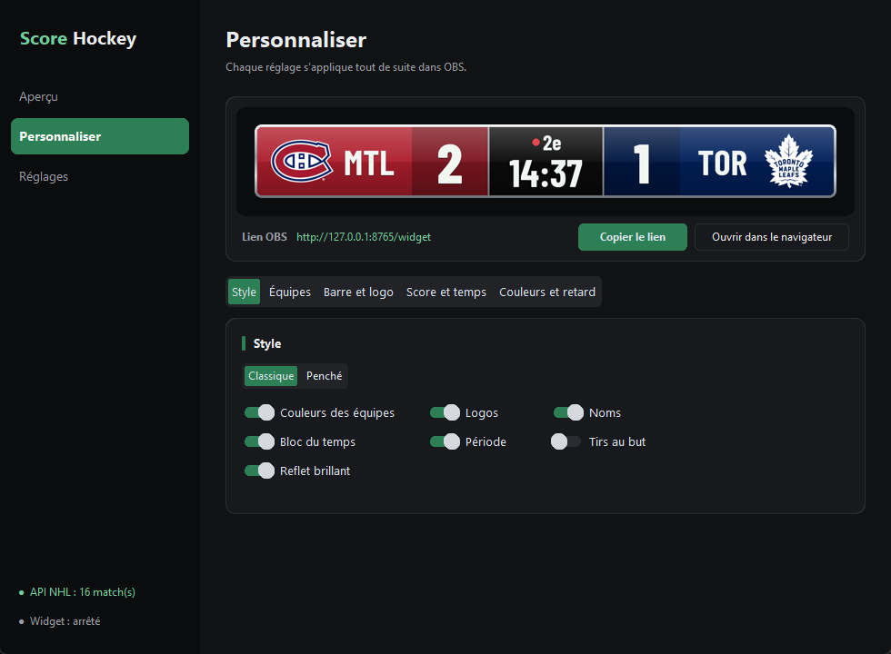

<p align="center">
  
</p>

<h1 align="center">Hockey Score Widget</h1>

<p align="center">
  Le score de la LNH en direct dans OBS, avec le look d'une vraie diffusion télé.<br>
  Gratuit, libre, sans compte et sans publicité.
</p>

<p align="center">
  <a href="https://github.com/tristanbest0802-beep/hockey-score-widget/releases/latest/download/HockeyScoreWidget-Setup.exe"></a>
  &nbsp;
  <a href="https://github.com/tristanbest0802-beep/hockey-score-widget/releases/latest/download/HockeyScoreWidget.exe"></a>
</p>

<p align="center">
  <sub><a href="#installation">Guide d'installation</a> · <a href="https://github.com/tristanbest0802-beep/hockey-score-widget/releases/latest">Notes de version</a> · Windows 10 et 11, 64 bits</sub>
</p>

<p align="center">
  <a href="https://github.com/tristanbest0802-beep/hockey-score-widget/releases/latest"></a>
  
  
  <a href="LICENSE"></a>
</p>

<p align="center">
  
</p>

## Sommaire

1. [Présentation](#présentation)
2. [Fonctionnalités](#fonctionnalités)
3. [Aperçu](#aperçu)
4. [Installation](#installation)
5. [Mise en place dans OBS](#mise-en-place-dans-obs)
6. [Utilisation](#utilisation)
7. [Tous les réglages](#tous-les-réglages)
8. [Vos données](#vos-données)
9. [Questions fréquentes](#questions-fréquentes)
10. [Désinstallation](#désinstallation)
11. [Développement](#développement)
12. [Licences et mentions légales](#licences-et-mentions-légales)

## Présentation

Hockey Score Widget est un petit logiciel Windows pour les streamers fans de hockey.
Il suit un match de la LNH en direct et affiche le score dans OBS, sous forme de bandeau
comme à la télé : logos, noms, score, période et temps restant.

Le logiciel crée lui-même la source dans OBS. Vous choisissez l'équipe à suivre
(les Canadiens par défaut), le style du bandeau, et c'est tout : le score se met à jour seul.

## Fonctionnalités

- **Score en direct** des 32 équipes de la LNH, mis à jour toutes les 10 secondes.
- **Suivi automatique** de votre équipe préférée, ou choix manuel parmi les matchs du jour.
- **9 presets de bandeau** en un clic : Classique, Penché, Classique simple, Logo d'équipe moderne,
  Minimaliste, Logos et fond texturé, Compact (coin), Élégant (contour doré), Large avec infos (tirs au but).
- **Couleurs et logos officiels** de chaque équipe, changés automatiquement selon le match.
- **Personnalisation complète** : nom, couleur et logo de chaque équipe, 16 réglages de taille et d'écart,
  éléments affichés, couleurs du bandeau.
- **Aperçu en direct** dans le logiciel : chaque réglage se voit tout de suite, sans ouvrir OBS.
- **Retard du score réglable** (0 à 120 secondes) : le but ne s'affiche pas avant l'image du stream.
- **Lien fixe** : vous collez le lien du widget une seule fois dans OBS, il ne change jamais.
- **Création de la source OBS en un clic** grâce à OBS WebSocket.
- **Animation** du score quand un but est marqué (désactivée si Windows demande moins d'animations).

## Aperçu

| Style classique | Style penché |
| --- | --- |
|  |  |

<p align="center">
  
</p>

<p align="center">
  
</p>

## Installation

1. Téléchargez **[`HockeyScoreWidget-Setup.exe`](https://github.com/tristanbest0802-beep/hockey-score-widget/releases/latest/download/HockeyScoreWidget-Setup.exe)**
   (ou passez par la page [Releases](https://github.com/tristanbest0802-beep/hockey-score-widget/releases/latest)).
2. Lancez-le et suivez l'assistant. Aucun droit administrateur n'est demandé.
   Le logiciel s'installe dans `%LOCALAPPDATA%\Programs\Hockey Score Widget`, avec un raccourci
   dans le menu Démarrer et, si vous le cochez, sur le bureau.

> **Avertissement Windows SmartScreen** : le logiciel n'est pas signé (un certificat coûte cher).
> Windows peut afficher « Windows a protégé votre ordinateur ». Cliquez sur *Informations complémentaires*,
> puis *Exécuter quand même*. Le fichier `SHA256SUMS.txt` de chaque version permet de vérifier le téléchargement.

**Sans installation** : [`HockeyScoreWidget.exe`](https://github.com/tristanbest0802-beep/hockey-score-widget/releases/latest/download/HockeyScoreWidget.exe) se lance directement,
sans raccourci ni désinstalleur.

**Configuration requise** : Windows 10 ou 11 (64 bits), OBS Studio 28 ou plus récent, une connexion internet.

## Mise en place dans OBS

1. Dans OBS : **Outils › Paramètres du serveur WebSocket**. Cochez *Activer le serveur WebSocket*
   et notez le port et le mot de passe.
2. Dans Hockey Score Widget, onglet **Réglages** : entrez l'adresse (`127.0.0.1`), le port et le mot de passe.
3. Cliquez sur **Tester la connexion**, puis sur **Créer la source dans OBS**.

C'est tout. Vous préférez le faire à la main ? Ajoutez une *Source navigateur* dans OBS
avec ce lien (bouton **Copier le lien** dans le logiciel) :

```text
http://127.0.0.1:8765/widget
```

Le lien reste le même quoi que vous changiez : équipe, match, style ou tailles.
Il ne change que si vous modifiez le port du widget dans **Réglages**.
Le logiciel doit rester ouvert pendant le stream : c'est lui qui envoie le score à OBS.

## Utilisation

Le logiciel a trois onglets, dans la barre de gauche.

**Aperçu** : le bandeau tel qu'il apparaît dans OBS, le lien du widget, et la liste des matchs du jour.
Laissez *Suivre automatiquement l'équipe préférée* activé (code `MTL`, `TOR`, `BOS`...)
ou cliquez sur un match pour le choisir.

**Personnaliser** : l'aperçu reste en haut, les réglages sont rangés en six sous-onglets (Presets, Style, Équipes, Barre et logo, Score et temps, Couleurs et retard).
Chaque changement part tout de suite dans OBS.

**Réglages** : connexion à OBS, port du widget, fréquence de mise à jour.

## Tous les réglages

| Bloc | Réglages |
| --- | --- |
| Presets | 9 styles prêts, appliqués en un clic (forme, tailles, éléments affichés) ; vos noms, couleurs et logos d'équipe sont gardés |
| Style | Couleurs des équipes ; logos ; noms ; bloc du temps ; période ; tirs au but ; reflet brillant |
| Équipes du match | Abréviation (`MTL`) ou nom (`Canadiens`) ; nom personnalisé ; couleur personnalisée ; logo personnalisé (PNG, JPG, SVG, WebP, GIF) ; bouton *Par défaut* |
| Barre | Hauteur ; arrondi des coins ; épaisseur du contour ; inclinaison (style penché) ; marge sur les côtés |
| Logo et nom | Taille du logo ; écart entre le logo et le nom ; taille du nom ; écart entre les lettres |
| Score | Taille des chiffres ; largeur de la case ; écart entre les chiffres |
| Temps | Taille du temps ; écart entre les chiffres ; taille de la période ; largeur du centre |
| Couleurs | Fond des équipes (quand leurs couleurs sont coupées) ; fond du temps ; texte |
| Retard du score | 0 à 120 secondes |

Chaque bloc de tailles a son bouton **Réinitialiser**.

## Vos données

- Aucun compte, aucune publicité, aucun suivi. Rien n'est envoyé à l'auteur.
- Le logiciel lit seulement les scores publics de la LNH (`api-web.nhle.com`) et ses logos (`assets.nhle.com`).
- La page du widget charge la police Barlow Condensed depuis Google Fonts.
- Le widget n'est accessible que depuis votre ordinateur (`127.0.0.1`), jamais depuis le réseau.
- Vos réglages, mot de passe OBS compris, sont enregistrés dans `%APPDATA%\HockeyScoreWidget\settings.json`.

## Questions fréquentes

**Le widget n'affiche rien.** Il n'y a peut-être pas de match aujourd'hui. Regardez la liste dans l'onglet *Aperçu*.
Vérifiez aussi que le logiciel est bien ouvert.

**« Port 8765 déjà pris ».** Un autre logiciel utilise ce port. Changez le port dans *Réglages*,
redémarrez le logiciel, puis recréez la source dans OBS.

**Le score arrive avant le but à l'écran.** Montez le *Retard du score* dans *Personnaliser*
jusqu'à ce que les deux tombent ensemble. Le retard dépend du diffuseur (RDS, TVA Sports...).

**Les autres ligues (LHJMQ, AHL...) ?** Pas pour l'instant : le logiciel lit seulement l'API de la LNH.

**L'API de la LNH a changé et plus rien ne marche.** Cette API n'est pas officiellement documentée.
Ouvrez une [issue](https://github.com/tristanbest0802-beep/hockey-score-widget/issues) : la correction tient dans un seul fichier.

## Désinstallation

*Paramètres Windows › Applications › Hockey Score Widget › Désinstaller.*
Vos réglages restent dans `%APPDATA%\HockeyScoreWidget` : supprimez ce dossier pour tout effacer.

## Développement

Python 3.14, CustomTkinter, simpleobsws, Pillow et resvg-py.

```bash
pip install -r requirements.txt -r requirements-dev.txt
python -m unittest discover -s tests -t .
python -m hockey_widget
```

Construire le programme puis l'installateur (Inno Setup 6) :

```bash
powershell -ExecutionPolicy Bypass -File build.ps1
```

```bash
iscc /DAppVersion=1.0.0 installer\HockeyScoreWidget.iss
```

**Publier une version** : poussez un tag `v1.2.3`. Le workflow `.github/workflows/release.yml` lance les tests,
construit `HockeyScoreWidget.exe` et `HockeyScoreWidget-Setup.exe`, calcule les empreintes SHA-256
et crée la release GitHub.

| Fichier | Rôle |
| --- | --- |
| `hockey_widget/app.py` | Fenêtre du logiciel et ses trois onglets |
| `hockey_widget/nhl_api.py` | Lecture de l'API de la LNH (seul fichier à corriger si l'API change) |
| `hockey_widget/teams.py` | Les 32 équipes : couleur et adresse du logo |
| `hockey_widget/widget.html` | Le bandeau affiché dans OBS |
| `hockey_widget/preview.py` | Le même bandeau dessiné dans le logiciel |
| `hockey_widget/server.py` | Petit serveur local pour OBS |
| `installer/` | Script et images de l'assistant d'installation |

## Licences et mentions légales

### Ce logiciel : GPL-3.0

Hockey Score Widget est un **logiciel libre et gratuit** sous [licence GNU GPL v3.0](LICENSE).

| Vous pouvez | À condition de | Sans |
| --- | --- | --- |
| L'utiliser librement, y compris en stream monétisé | Garder la mention de la licence et de l'auteur | Garantie : le logiciel est fourni tel quel |
| Le copier et le partager | Partager le code source de toute version modifiée que vous distribuez | Responsabilité de l'auteur en cas de problème |
| Le modifier et publier votre version | Garder la même licence GPL-3.0 pour cette version | |

### Composants tiers

Le programme contient des composants libres, chacun sous sa propre licence
(MIT, BSD, Apache-2.0, PSF, SIL Open Font License). La liste complète, avec versions et liens,
est dans [THIRD_PARTY_NOTICES.md](THIRD_PARTY_NOTICES.md). Elle est aussi installée avec le logiciel.

- Police **Barlow Condensed** : SIL Open Font License 1.1 ([texte](hockey_widget/fonts/OFL.txt)).
- **Logo** du logiciel : créé pour ce projet, sous la même licence GPL-3.0.

### Marques

LNH, NHL, le bouclier de la LNH, ainsi que les noms et logos des équipes sont des marques de la
Ligue nationale de hockey et de ses équipes. **Ce projet est indépendant** : il n'est ni affilié,
ni approuvé, ni soutenu par la LNH ou une de ses équipes. Les logos ne sont pas inclus dans le logiciel :
ils sont chargés depuis les serveurs de la LNH, comme sur son site. Les scores viennent de l'API web publique
de la LNH, gratuite, sans clé et non documentée officiellement.

---

<p align="center">Fait par Blackoune, pour les streamers qui vivent chaque but en direct.</p>
